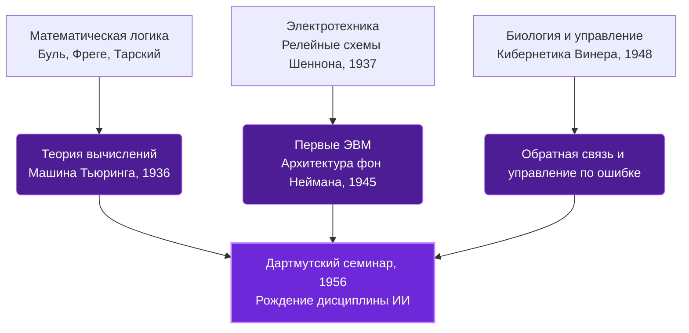

# 01. Колыбель кибернетики: логика, машина Тьюринга и Дартмутский семинар

Любая современная компьютерная программа опирается на понятие [алгоритма](../99_Словарь_Терминов/Алгоритм.md) — конечного набора строгих пошаговых инструкций. Но прежде чем учить компьютеры распознавать образы или генерировать осмысленный текст, науке пришлось ответить на куда более дерзкий вопрос: **«Можно ли вообще свести человеческую мысль к набору механических правил?»** Эта открывающая глава о том, как философы, математики и инженеры превратили абстрактное мышление в точную дисциплину и заложили фундамент всех современных вычислений.

---

## 🟢 Уровень 0: Интуиция

Тысячи лет считалось, что разум, интуиция и логика — это исключительные свойства живого мозга. Счёты или механические арифмометры умели складывать числа при помощи костей и шестерёнок соответственно, но никто не понимал, как заставить механизм *рассуждать*, делать выводы из фактов или исправлять собственные ошибки.

Чтобы понять, как был взломан этот барьер, представьте человека, который сидит в закрытой комнате и вообще не знает языка, на котором написаны документы. Перед ним лежат всего два предмета:
1. Бесконечная бумажная лента, разделённая на клеточки, где карандашом вписаны символы.
2. Книга простых правил вида: *«Если ты видишь в клеточке символ А и твоя закладка лежит на странице 3 — сотри А, напиши Б, сдвинь ленту на одну клетку вправо и переложи закладку на страницу 5»*.

Сам человек не вникает в смысл текста — он просто сверяет текущую букву со строчкой в книге. Но в 1936 году английский математик Алан Тьюринг доказал поразительную вещь: с помощью такой примитивной ленты и таблицы правил можно решить **абсолютно любую задачу во Вселенной, у которой в принципе существует пошаговое решение**. 

Раз любое сложное рассуждение раскладывается на элементарные чтения и перезаписи символов, значит, мышление не привязано к биологической ткани — его можно воспроизвести в металле и кремнии.

---

## 🟡 Уровень 1: Концепция и архитектура

Переход от бумажной метафоры Тьюринга к реальному искусственному интеллекту произошел на пересечении четырех инженерных идей в середине XX века.

### Четыре столпа зарождения ИИ

1. **Математическая логика и релейные схемы (Джордж Буль и Клод Шеннон):**
   Ещё в 1854 году Джордж Буль показал, что человеческие высказывания («Истина» и «Ложь») можно складывать и перемножать как нули и единицы. А в 1937 году 21-летний Клод Шеннон в своей магистерской диссертации доказал, что булеву алгебру можно напрямую спаять из электрических переключателей (реле). Замкнутая цепь означает `1` (Истина), разомкнутая — `0` (Ложь). Так чистая логика обрела физическое воплощение.
2. **Универсальная машина и Тест Тьюринга (Алан Тьюринг):**
   Помимо доказательства того, что одно устройство способно выполнять *любую* программу (если хранить саму программу на ленте памяти вместе с данными), в 1950 году Тьюринг предложил прагматичный критерий разума. В статье *«Computing Machinery and Intelligence»* он заменил размытый философский вопрос «Может ли машина мыслить?» на **Игру в имитацию (Тест Тьюринга)**: если в слепой текстовой переписке человек-судья не способен отличить машину от живого собеседника, мы обязаны признать поведение машины интеллектуальным.
3. **Кибернетика и обратная связь (Норберт Винер, 1948):**
   Винер заметил, что рука человека, тянущаяся за стаканом воды, и радар зенитной установки работают по одному принципу — **отрицательной обратной связи**. Система непрерывно измеряет отклонение от цели (ошибку) и корректирует следующее движение. В современном ИИ эта концепция напрямую превратилась в минимизацию [функции потерь](../99_Словарь_Терминов/Функция_потерь.md).
4. **Дартмутский семинар (Лето 1956 года):**
   Джон Маккарти, Марвин Минский, Клод Шеннон и Натаниэль Рочестер собрали ведущих ученых на двухмесячный семинар в Дартмутском колледже. Именно в заявке на эту встречу Маккарти впервые ввел термин **«Искусственный интеллект» (Artificial Intelligence)** и сформулировал базовую гипотезу всей дисциплины: каждый аспект обучения или любая другая черта интеллекта может быть описана настолько точно, что для её симуляции можно построить машину.

### Архитектурная схема истоков ИИ


### Плюсы, минусы и компромиссы раннего подхода
* **Преимущества:** 
	строгая математическая доказуемость; 
	отделение физической аппаратуры от программного кода; 
	рождение первых программ, способных самостоятельно доказывать математические теоремы (*Logic Theorist* Ньюэлла и Саймона).
* **Ограничения:**
  * *Парадокс Моравека и наивный оптимизм:* 
	  *участники Дартмутского семинара полагали, что решат задачу машинного зрения и перевода за одно лето силами десяти человек. Оказалось, что сложные для человека задачи (логические игры, интегралы) даются компьютеру легко, а естественные для трехлетнего ребенка навыки (узнать лицо мамы, поднять чашку) практически невозможно описать жесткими правилами «если — то».
  * *Уязвимость Теста Тьюринга:* 
	внешняя имитация диалога еще не означает наличия внутренней модели мира и понимания.

---

## 🔴 Уровень 2: Математический аппарат

Переведём описанные выше идеи на строгий язык дискретной математики и теории вычислимости.

### 1. Булева алгебра и полнота логических базисов
Любое логическое правило в компьютере представляется как булева функция $f: \{0, 1\}^n \to \{0, 1\}$. Базовые операции над битами $x, y \in \{0, 1\}$ можно записать через обычную арифметику:
* **Конъюнкция (И / AND):** $x \land y = \min(x, y) = x \cdot y$
* **Дизъюнкция (ИЛИ / OR):** $x \lor y = \max(x, y) = x + y - x \cdot y$
* **Отрицание (НЕ / NOT):** $\neg x = 1 - x$
* **Исключающее ИЛИ (XOR):** $x \oplus y = (x - y)^2 = (x \land \neg y) \lor (\neg x \land y)$

Теорема о совершенной дизъюнктивной нормальной форме (СДНФ) гарантирует функциональную полноту: **любую** таблицу истинности сколь угодно сложной логической задачи можно выразить через суперпозицию трёх базовых операций $\{\land, \lor, \neg\}$.

### 2. Формальное определение Машины Тьюринга
Детерминированная одноленточная машина Тьюринга задаётся упорядоченной семёркой множеств и функций:

$$M = \langle Q, \Sigma, \Gamma, \delta, q_0, q_{\text{accept}}, q_{\text{reject}} \rangle$$

Где:
* $Q$ — конечное непустое множество внутренних **состояний** управляющего автомата;
* $\Sigma$ — входной **алфавит** (не содержащий пустого символа $\sqcup$);
* $\Gamma$ — ленточный алфавит, причем $\Sigma \subset \Gamma$ и $\sqcup \in \Gamma$;
* $q_0 \in Q$ — начальное состояние;
* $q_{\text{accept}}, q_{\text{reject}} \in Q$ — терминальные состояния допуска и отказа ($q_{\text{accept}} \neq q_{\text{reject}}$);
* $\delta$ — **функция переходов** (программа машины), отображающая пару «текущее состояние, прочитанный символ» в тройку «новое состояние, записываемый символ, сдвиг головки» (влево $L$, вправо $R$ или на месте $S$):

$$\delta: (Q \setminus \{q_{\text{accept}}, q_{\text{reject}}\}) \times \Gamma \to Q \times \Gamma \times \{L, R, S\}$$

Согласно **тезису Чёрча — Тьюринга**, любая интуитивно вычислимая функция вычислима на машине Тьюринга. Современный кластер из тысяч видеокарт в фундаментальном смысле вычисляет ровно тот же класс функций, что и эта абстрактная лента — разница заключается исключительно во времени работы и параллелизме.

### 3. Проблема остановки (Halting Problem) — строгий предел любого ИИ
Можно ли создать идеальный ИИ-верификатор, который по исходному коду произвольной программы $P$ и её входу $x$ за конечное время безошибочно определит, завершит ли $P(x)$ работу или зависнет в бесконечном цикле? Тьюринг доказал **от противного**, что такой функции не существует.

Предположим противное: пусть существует всюду определенная вычислимая функция $H(P, x)$:

$$H(P, x) = \begin{cases} 1, & \text{если } P(x) \text{ останавливается за конечное число шагов}, \\ 0, & \text{если } P(x) \text{ работает бесконечно}. \end{cases}$$

Построим программу-антагонист $D(P)$, которая принимает на вход текст программы $P$, запускает анализатор $H(P, P)$ и поступает наоборот:
1. Если $H(P, P) = 1$, программа $D$ входит в бесконечный цикл (`while True: pass`).
2. Если $H(P, P) = 0$, программа $D$ немедленно возвращает `1` и останавливается.

Подадим программе $D$ её собственный исходный код — вызовем $D(D)$:
* Если $D(D)$ останавливается $\implies H(D, D) = 1 \implies$ по первой ветке своего кода $D(D)$ обязана зависнуть навсегда. Противоречие.
* Если $D(D)$ зависает $\implies H(D, D) = 0 \implies$ по второй ветке $D(D)$ обязана мгновенно остановиться. Противоречие.

Следовательно, универсального алгоритма $H(P, x)$ не существует. Это задает строгий математический предел для любых будущих языковых моделей и статических анализаторов: **никакая нейросеть не может со 100% точностью предсказывать свойства произвольного алгоритма без его прямого пошагового выполнения.**

### 4. От обратной связи Винера к градиентному спуску
В кибернетике Винера корректировка состояния системы $s_t$ пропорциональна ошибке $e_t = y_{\text{target}} - y_t$:

$$s_{t+1} = s_t + K \cdot (y_{\text{target}} - y_t)$$

В обучении нейросетей этот же контур отрицательной обратной связи записывается через [градиент](../99_Словарь_Терминов/Градиент.md) [функции потерь](../99_Словарь_Терминов/Функция_потерь.md) $\mathcal{L}(\theta)$ по параметрам модели $\theta$:

$$\theta_{t+1} = \theta_t - \eta \nabla_\theta \mathcal{L}(\theta_t)$$

---

## ⚫ Уровень 3: Код и инженерные тонкости

Реализуем оба подхода в коде: сначала классическую символьную машину Тьюринга, а затем покажем, как один свёрточный слой в PyTorch воспроизводит Тьюринг-полные вычисления в [тензорах](../99_Словарь_Терминов/Тензор.md).

### 1. Универсальная Машина Тьюринга на чистом Python
В качестве таблицы переходов $\delta$ зададим алгоритм прибавления единицы к двоичному числу с учётом переноса разряда:

```python
from typing import Dict, Tuple

State = str
Symbol = str
Direction = int  # -1 (влево L), +1 (вправо R), 0 (на месте S)
TransitionTable = Dict[Tuple[State, Symbol], Tuple[State, Symbol, Direction]]


class TuringMachine:
    def __init__(
        self,
        tape_str: str,
        transitions: TransitionTable,
        start_state: State = "q_right",
        accept_state: State = "q_accept",
        blank: Symbol = "_",
    ):
        self.tape: Dict[int, Symbol] = {i: ch for i, ch in enumerate(tape_str)}
        self.head: int = 0
        self.state: State = start_state
        self.transitions = transitions
        self.accept_state = accept_state
        self.blank = blank

    def step(self) -> bool:
        if self.state == self.accept_state:
            return False
        current_symbol = self.tape.get(self.head, self.blank)
        key = (self.state, current_symbol)

        if key not in self.transitions:
            raise RuntimeError(f"Остановка по ошибке: нет правила для {key}")

        next_state, write_symbol, move_dir = self.transitions[key]
        self.tape[self.head] = write_symbol
        self.head += move_dir
        self.state = next_state
        return self.state != self.accept_state

    def render(self) -> str:
        min_idx = min(min(self.tape.keys(), default=0), self.head)
        max_idx = max(max(self.tape.keys(), default=0), self.head)
        cells = [
            f"[{self.tape.get(i, self.blank)}]" if i == self.head else f" {self.tape.get(i, self.blank)} "
            for i in range(min_idx, max_idx + 1)
        ]
        return f"{''.join(cells)}  (state={self.state})"


# Правила инкремента двоичного числа (1011 -> 1100)
binary_increment_rules: TransitionTable = {
    ("q_right", "0"): ("q_right", "0", +1),
    ("q_right", "1"): ("q_right", "1", +1),
    ("q_right", "_"): ("q_carry", "_", -1),  # Дошли до конца числа, идем влево
    ("q_carry", "1"): ("q_carry", "0", -1),  # 1 + 1 = 0, перенос идет дальше влево
    ("q_carry", "0"): ("q_accept", "1", 0),  # 0 + 1 = 1, перенос завершён
    ("q_carry", "_"): ("q_accept", "1", 0),  # Новый старший разряд (111 -> 1000)
}

if __name__ == "__main__":
    tm = TuringMachine(tape_str="1011", transitions=binary_increment_rules)
    print("Старт: ", tm.render())
    while tm.step():
        print("Шаг:   ", tm.render())
    print("Финал: ", tm.render())
```

### 2. Тьюринг-полнота одного сверточного слоя на PyTorch
Символьные алгоритмы и матричные нейросети тесно связаны: рекуррентное применение всего одного одномерного свёрточного слоя (`nn.Conv1d`) с активацией `ReLU` способно симулировать Тьюринг-полный клеточный автомат **Rule 110** исключительно за счёт матричных операций без единого оператора `if`:

```python
import torch
import torch.nn as nn
import torch.nn.functional as F


class NeuralRule110(nn.Module):
    """
    Тьюринг-полный клеточный автомат Rule 110 на тензорных операциях PyTorch.
    Таблица переходов для тройки соседних бит (L, C, R):
    111->0, 110->1, 101->1, 100->0, 011->1, 010->1, 001->1, 000->0
    """

    def __init__(self):
        super().__init__()
        # Свёртка переводит битовую тройку (L, C, R) в десятичный индекс 4*L + 2*C + 1*R (от 0 до 7)
        self.conv = nn.Conv1d(in_channels=1, out_channels=1, kernel_size=3, padding=1, bias=False)
        with torch.no_grad():
            self.conv.weight.copy_(torch.tensor([[[4.0, 2.0, 1.0]]]))

        # Значения таблицы истинности для состояний 0..7
        self.lut = nn.Parameter(torch.tensor([0.0, 1.0, 1.0, 1.0, 0.0, 1.0, 1.0, 0.0]), requires_grad=False)

    def forward(self, tape: torch.Tensor) -> torch.Tensor:
        # tape: [batch_size, 1, tape_len]
        pattern_idx = self.conv(tape)  # [B, 1, L]

        # Выделяем активный индекс через треугольный импульс ReLU(1 - |idx - k|)
        k = torch.arange(8, device=tape.device, dtype=tape.dtype).view(1, 8, 1)
        one_hot = F.relu(1.0 - torch.abs(pattern_idx - k))  # [B, 8, L]

        return torch.einsum("bkl,k->bl", one_hot, self.lut).unsqueeze(1)


if __name__ == "__main__":
    model = NeuralRule110()
    tape = torch.zeros(1, 1, 32)
    tape[0, 0, -2] = 1.0

    for step in range(12):
        print(f"t={step:02d}: " + "".join("█" if b > 0.5 else "·" for b in tape[0, 0]))
        tape = model(tape)
```

### Узкие места на железе: наследие фон Неймана в эпоху LLM
В 1945 году Джон фон Нейман спроектировал физическую архитектуру компьютера по образцу машины Тьюринга, разделив вычислительное ядро (процессор) и память (ленту). Это породило **бутылочное горлышко фон Неймана**: процессор простаивает большую часть времени, ожидая пересылки данных из памяти по шине.

Сегодня именно это ограничение 1945 года является главной проблемой при запуске больших языковых моделей. Генерация каждого нового слова упирается не в вычислительную мощность чипа (FLOPs), а в пропускную способность видеопамяти (**Memory-bound режим**): видеокарте приходится на каждом шаге перекачивать гигабайты весов из памяти HBM в регистры SRAM. Все современные трюки ускорения ИИ — от квантизации до алгоритма FlashAttention — созданы ради того, чтобы реже ходить в «ленту памяти» фон Неймана.

---

## 🔗 Связи в графе и что читать дальше

* **Раздел и главная:** [📂 01. История и Философия ИИ](00_Индекс.md) | [🏠 Главная страница репозитория](../README.md)
* **Связанные темы из будущих разделов:**
  * [08.03 Латентные и рекуррентные рассуждения](../08_Модели_Рассуждений_Мультимодальность_и_Передний_Край/03_Латентные_и_рекуррентные_рассуждения.md)
  * [08.06 Абстрактное мышление и ARC-AGI](../08_Модели_Рассуждений_Мультимодальность_и_Передний_Край/06_Абстрактное_мышление_и_ARC_AGI.md)
* **Термины из словаря:** [Алгоритм](../99_Словарь_Терминов/Алгоритм.md), [Тензор](../99_Словарь_Терминов/Тензор.md), [Функция потерь](../99_Словарь_Терминов/Функция_потерь.md), [Градиент](../99_Словарь_Терминов/Градиент.md)
* **Первоисточники:**
  1. *Turing, A. M. (1936) — "On Computable Numbers, with an Application to the Entscheidungsproblem"*
  2. *Shannon, C. E. (1938) — "A Symbolic Analysis of Relay and Switching Circuits"*
  3. *Turing, A. M. (1950) — "Computing Machinery and Intelligence"*
  4. *McCarthy, J. et al. (1955) — "A Proposal for the Dartmouth Summer Research Project on Artificial Intelligence"*

> **Что дальше:** В то время как Тьюринг и Шеннон строили вычислители на жестких логических правилах, другая группа учёных попыталась скопировать саму ткань живого мозга. В следующей главе разберем, как появилась первая математическая модель нейрона, как работал перцептрон Розенблатта и почему простая операция XOR заморозила исследования нейросетей на долгие годы → **[02. Ранний коннекционизм: нейрон Мак-Каллока — Питтса, перцептрон и проблема XOR](02_Ранний_коннекционизм.md)**